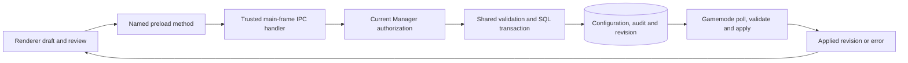

# Build and maintain the desktop editor

The editor is source code in the framework repository. The portable executable is
a generated convenience build, not the only way to use or modify it. There is no
separate closed editor backend and no web-host requirement.

## Build from a clean checkout

Use a complete framework checkout on Windows x64, with Node.js 22.12 or newer and
npm available in your terminal. CI uses Node.js 24. An internet connection is
needed for the first dependency/Electron download; no database is needed to build.

From the framework root:

```sh
cd desktop
npm ci --include=dev
npm run build
```

Close any running copy from `desktop/dist/` before rebuilding it. The build
prepares the pinned Electron runtime, checks syntax and formatting, runs the
editor's tests and creates:

```text
desktop/dist/OpenRP Framework Editor-win32-x64/
  OpenRP Framework Editor.exe
  resources/
  ...Electron runtime files...
```

Distribute that **whole folder**. The executable alone cannot load its resources.
The build is unsigned; release signing, an installer and automatic updates are
separate distribution work. Windows node-pty prebuilds are included in its pinned
package. Native build tools are only needed if you replace/rebuild that dependency
or use a target without matching prebuilds.

`npm run setup` handles npm configurations which skipped Electron's install hook.
It never opens a database. A failed runtime download requires fixing connectivity
or your package policy; the build does not silently substitute another version.

## Development commands

| Command, from `desktop/`                                              | Purpose                                                                            |
| --------------------------------------------------------------------- | ---------------------------------------------------------------------------------- |
| `npm start`                                                           | Open the source application in Electron                                            |
| `npm run setup`                                                       | Check Node and prepare pinned desktop dependencies                                 |
| `npm run check`                                                       | Check required repo files, JavaScript syntax and formatting                        |
| `npm run format`                                                      | Apply the pinned source formatter                                                  |
| `npm test`                                                            | Run isolated authorization, profiles, history, catalogue and process tests         |
| `npm run build`                                                       | Prepare, check, test and produce the Windows portable app                          |
| `npm run package:win`                                                 | Package only; useful after checks already passed                                   |
| `npm run admin:create -- --name Admin_User --email owner@example.com` | Owner-run first-admin bootstrap, using `DATABASE_URL` from the process environment |

Source changes are picked up on the next `npm start`; there is no frontend dev
server or hot-module replacement. Restart after changing main/preload code. Run
the formatter before the check if you changed source layout.

## Source map

| File/directory                           | Responsibility                                                                              |
| ---------------------------------------- | ------------------------------------------------------------------------------------------- |
| `src/main.mjs`                           | Electron lifecycle, local protocol, trusted IPC handlers, service wiring and graceful close |
| `src/preload.cjs`                        | Explicit `window.editor` operation bridge; no raw IPC or Node APIs                          |
| `src/session.mjs`                        | SQL connection options, Manager login/MFA, reauthorization and shared-repository calls      |
| `src/profiles.mjs`                       | Whitelisted profile payload, atomic local file writes and encrypted credential reuse        |
| `src/history.mjs`                        | Whether a historical change can be restored by the desktop                                  |
| `src/server.mjs`                         | Owned game process, native Windows console and bounded logs                                 |
| `ui/index.html`                          | Static app shell, login tabs and modal containers                                           |
| `ui/app.js`                              | Screens, filters, form drafts, review and narrow API calls                                  |
| `ui/styles.css`                          | Theme tokens, components, responsive connection layout and modal styling                    |
| `scripts/`                               | Dependency checks, source checks, administrator bootstrap and portable packaging            |
| `test/`                                  | Public tests with fake SQL/crypto or owned disposable child processes                       |
| `../web-platform/shared/runtime-config/` | Canonical definitions, validation, SQL transactions, catalogues and editor-ownership rules  |
| `../database/schema.sql`                 | Complete fresh-install SQL baseline                                                         |

Do not copy only `desktop/` into another directory: relative imports require the
shared configuration source. Tests also compare weapon labels with the gamemode's
custom gun table. The complete source tree provides those dependencies.

## How an edit reaches the game



`render()` displays a loaded snapshot. `edit()` builds a draft. `review()` stores a
patch together with the revision that was originally loaded. Only the separate
confirmation invokes `window.editor.save()`. A stale revision is rejected instead
of overwriting another ACP/desktop edit.

SQL is accessed in main through `EditorSession`; never add database credentials,
SQL queries, filesystem APIs or process spawning to the renderer. The shared
repository owns its transaction boundaries. Do not wrap `getConfiguration()` or
`getEntities()` inside an unrelated write transaction: their own begin/commit
would interfere with it.

The game must understand a new runtime field before the UI can promise it applies
live. A successful SQL save is not an applied acknowledgement. Follow the
[database change guide](DATABASE-CHANGES.md) when extending that contract.

## Add a screen or action

For a display-only screen, add the navigation button in `ui/index.html`, its title
and `render()` branch in `ui/app.js`, and scoped component styles. Reuse escaped
labels/card helpers and existing search/filter conventions. Keep technical IDs
available without making them the only readable label.

For a privileged new operation:

1. Implement its logic in a main-process service or the shared repository.
2. Register one named handler through `handle()` in `src/main.mjs`.
3. Expose one matching method in `src/preload.cjs`.
4. Call it from the renderer; use `run()` for sanitized error notices.
5. Test both permitted and forbidden requests, including stale or changed accounts.

Keep the exact main-frame sender check, operation serialization, context isolation,
renderer sandbox, CSP, denied navigation/popups and disabled Node integration.
Do not replace the bridge with arbitrary SQL, a generic shell command or raw
`ipcRenderer.invoke` access. Display dynamic text through the escaping helper.

## Profiles and authentication

Profiles are local app preferences under Electron's Windows app-data directory.
They are not game tables and do not belong in the repository. `profileDetails()`
defines their encrypted payload; `publicDetails()` strips stored passwords before
returning UI metadata. Reusing a saved password requires the same connection and
Manager identity. A saved Manager password still passes the current bcrypt,
password-version, ban, rank and MFA checks.

If you change the account schema or password implementation, update the queries
and verifier in `src/session.mjs`, the first-admin bootstrap, and the equivalent
web/game authentication paths. Do not bypass authorization to work around a field
rename. Profile-format changes need an explicit version/migration inside the
encrypted main-process store, or a clear request to forget/recreate the profile;
never fall back to plaintext.

## Tests and manual verification

The public tests do not connect to a community database or send email. Profile
unit tests inject a test cipher; real Windows safeStorage still needs a manual
save/close/reopen test. Process unit tests inject owned Node children; they do not
prove a complete open.mp installation works.

Before releasing changes involving persistence or native controls:

- Build from clean source and open the generated portable app.
- Use a separate fresh database imported from `database/schema.sql`, bootstrap
  a test Manager and check both valid/invalid credentials.
- Save a named connection, close/reopen, verify protected-password reuse, then
  forget it. Verify email MFA with your own local mail catcher if changed.
- Check edits, review/cancel, a second editor causing a revision conflict, history
  restore, demotion and server acknowledgement without a restart.
- For process changes, choose a **separate** loopback game installation. Check
  duplicate-start rejection, graceful stop and close while running; never target
  a community process for destructive failure tests.
- Check the login tabs at the minimum supported window size and conditionally
  visible fields, including switching a new location into/out of fishing mode.

Public database integration checks also exist under `tools/runtime-config/`;
follow that directory's README and its disposable-database name guard. Never run
schema import tests against existing player data.

## What is included in Git and builds

Commit source, comments, docs, tests, `package.json` and `package-lock.json`.
`node_modules/`, `.build/`, `dist/` and local logs are ignored. The package script
stages an explicit allowlist: editor source/UI, production dependencies, shared
configuration source and licence/credits. It does not copy the game checkout,
`.local-preview`, database dumps, personal profiles or private environment files.

The Windows CI workflow checks and builds the editor from the repository and
uploads the portable folder as a workflow artifact. It does not publish a release,
deploy a website or connect to your database. Keep the lockfile pinned and verify
that CI stays green when changing dependencies or shared data contracts.
